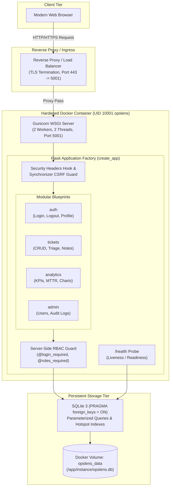
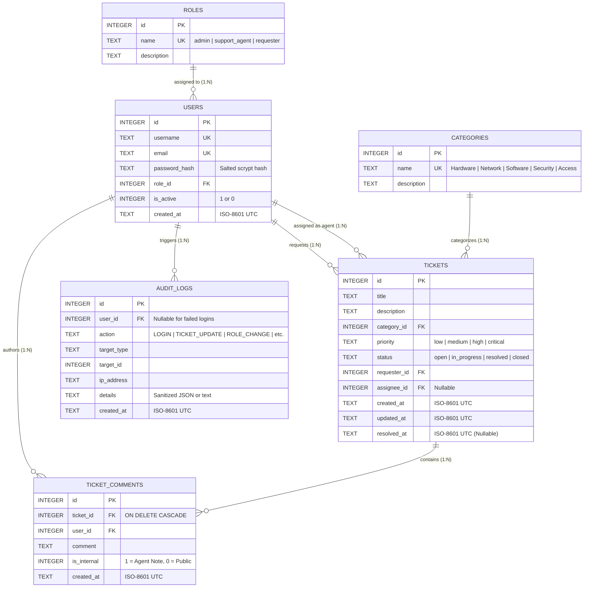

# OpsLens &mdash; Smart IT Helpdesk & Incident Analytics Platform

[](https://www.python.org/)
[](https://palletsprojects.com/p/flask/)
[](https://sqlite.org/)
[-brightgreen.svg)](https://pytest.org/)
[](https://www.docker.com/)
[](.github/workflows/ci.yml)
[](#-defense-in-depth-security-architecture)

**OpsLens** is a security-hardened, production-grade IT Service Management (ITSM) and Incident Analytics platform designed to model real-world enterprise operations (e.g., ServiceNow, Jira Service Management, PagerDuty). Built with **Python/Flask**, **SQLite**, **Gunicorn**, and **Docker**, it combines robust relational database architecture with defense-in-depth cybersecurity engineering and automated DevSecOps pipelines.

Created for a technical portfolio defense and software engineering interviews, OpsLens demonstrates end-to-end development: from normalized SQL schemas and server-side Role-Based Access Control (RBAC) to containerization, vulnerability auditing, and automated testing.

---

## ⚡ Key Platform Capabilities

### 1. Executive Incident Analytics & SLA Intelligence
- **Operational KPI Telemetry**: Real-time tracking of total volume, active incidents, in-progress triages, resolved counts, and critical P1 outages.
- **Dynamic Date Windowing**: Filter analytics across **7-Day**, **30-Day**, **90-Day**, or **Custom Date Ranges** with an exclusive start-of-next-day boundary (`< end_date + 1 day`) to accurately capture all end-date transactions without clipping fractional seconds.
- **Resolution Velocity Metrics**:
  - **Mean Time to Resolution (MTTR)**: Evaluated directly in SQL using Julian day arithmetic (`(julianday(resolved_at) - julianday(created_at)) * 24.0`).
  - **Median Time to Resolution**: Exact percentile computation handling odd and even resolved ticket populations.
- **Overdue SLA Detection**: Clear separation of globally overdue open tickets versus overdue incidents within filtered reporting windows.
- **Recurring Issue Pattern Clustering**: Algorithmic grouping of repeat incidents across categories to pinpoint systemic infrastructure bottlenecks (e.g., VPN timeouts, IAM desyncs).
- **Interactive Visualizations**: Clean, responsive charts powered by **Chart.js** displaying status breakdowns, severity distributions, and category trends.

### 2. Incident Lifecycle Management (CRUD & Collaboration)
- **Full Ticket Lifecycle**: Ticket submission, triage assignment, multi-parameter search (keyword query across title/description, category, priority, status), and pagination.
- **Collaborative Activity Timeline**: Public user discussion threads coupled with **confidential internal support notes** (strictly hidden from end-user requesters).
- **State Machine Integrity**: Structured status progression (`open` &rarr; `in_progress` &rarr; `resolved` &rarr; `closed`) with automated timestamp recording (`resolved_at`).

### 3. Enterprise Role-Based Access Control (RBAC)
- **System Administrator (`admin`)**: Complete platform governance, user management, administrative role assignment, full ticket queues, and system audit log exploration.
- **Support Agent (`support_agent`)**: Dedicated triage queue, ticket assignment, status/priority escalation, and authoring/viewing confidential internal notes.
- **Standard Requester (`requester`)**: Strict least-privilege isolation &mdash; requesters can submit tickets, track their own submissions, add public comments, and close resolved tickets they raised. Requesters are strictly forbidden from viewing other users' tickets or reading internal notes.

### 4. Enterprise Audit Log Explorer & Reporting
- **Forensic Audit Log Trail**: Administrative portal querying system events with timestamp, actor username, event action, affected target, client IP address, and metadata.
- **Safe CSV Data Exports**: Independently filtered CSV data export for tickets and analytics reports, reinforced with **CSV Formula Injection defense** to protect spreadsheet users.

---

## 🏗️ Architecture & Technology Stack



### Technology Matrix
| Layer | Technologies | Justification & Architecture Notes |
|---|---|---|
| **Language & Runtime** | Python 3.12 (Docker), 3.11/3.12 (CI Matrix), 3.14 (Verified Local) | Modern Python runtime with strict typing compatibility and security patches. |
| **Web Framework** | Flask 3.1.3, Werkzeug 3.1.9 | Application Factory pattern with modular Blueprints (`auth`, `tickets`, `analytics`, `admin`). |
| **WSGI Server** | Gunicorn 23.0.0 | Production-grade WSGI HTTP server with multi-worker, multi-threaded configuration. |
| **Database** | SQLite 3 (C-level embedded engine) | Relational 3NF design with runtime foreign keys (`PRAGMA foreign_keys = ON`) and zero-overhead embedded queries. |
| **Frontend** | Semantic HTML5, CSS3 Grid/Flexbox, ES6 JavaScript | Clean server-rendered UI via Jinja2 with auto-escaping; Chart.js 4.4.1 for interactive telemetry. |
| **Containerization** | Docker, Docker Compose | Multi-stage, non-root user (`UID 10001`), immutable image with persistent named volume. |
| **Testing & CI/CD** | pytest 9.1.1, pytest-cov 7.1.0, GitHub Actions, pip-audit | 85 automated tests enforcing a strict **90% coverage floor** and vulnerability audits. |

---

## 🗄️ Relational Database Schema (3NF)

OpsLens uses a strictly normalized (Third Normal Form) relational schema with foreign key cascading and dedicated performance indexes on critical filter columns.



### Relational Indexes
- `idx_tickets_status` on `tickets(status)` &mdash; Accelerates triage queues and status KPI counts.
- `idx_tickets_priority` on `tickets(priority)` &mdash; Accelerates severity distributions and P1 alerts.
- `idx_tickets_category` on `tickets(category_id)` &mdash; Optimizes category analytics and recurring pattern detection.
- `idx_tickets_created_at` on `tickets(created_at)` &mdash; Optimizes date-window range queries (`7d`, `30d`, `90d`, custom).
- `idx_tickets_requester` on `tickets(requester_id)` &mdash; Enforces rapid requester ownership filtering.
- `idx_tickets_assignee` on `tickets(assignee_id)` &mdash; Accelerates agent workload queues.
- `idx_audit_logs_action` on `audit_logs(action)` &mdash; Speeds up forensic filtering by event type.

---

## 🛡️ Defense-in-Depth Security Architecture

As a platform designed with a cybersecurity focus, OpsLens applies layered defensive controls across all tiers:

| Vulnerability / Threat Class | MITRE CWE / OWASP | Defensive Control in OpsLens | Source Code Location |
|---|---|---|---|
| **SQL Injection (SQLi)** | CWE-89 / OWASP A03 | 100% Parameterized queries with `?` placeholders across all routes and analytics. Zero dynamic string concatenation. | [`app/tickets/routes.py`](file:///Users/abhinavchaudhary/opslens/app/tickets/routes.py)<br/>[`app/analytics/routes.py`](file:///Users/abhinavchaudhary/opslens/app/analytics/routes.py) |
| **CSV Formula Injection** | CWE-1236 | Sanitizes all user-controlled text cells. Prefixes trigger symbols (`=`, `+`, `-`, `@`, `\t`, `\r`) with single quotes (`'`) before CSV export generation. | [`app/security/csv_defense.py`](file:///Users/abhinavchaudhary/opslens/app/security/csv_defense.py) |
| **Cross-Site Request Forgery (CSRF)** | CWE-352 / OWASP A01 | Synchronizer Token Pattern on all state-changing HTTP methods (`POST`, `PUT`, `DELETE`). Cryptographically secure tokens validated with constant-time equality checks. | [`app/security/csrf.py`](file:///Users/abhinavchaudhary/opslens/app/security/csrf.py) |
| **Broken Object Level Authorization (BOLA/IDOR)** | CWE-285 / OWASP A01 | Strict server-side verification: Requesters can only access, edit, comment on, or export tickets where `requester_id == g.user['id']`. | [`app/tickets/routes.py`](file:///Users/abhinavchaudhary/opslens/app/tickets/routes.py) |
| **Credential Storage & Cracking** | CWE-307 / OWASP A07 | Passwords hashed using modern `scrypt` salted key-derivation function. Generic error messages prevent account enumeration. | [`app/auth/routes.py`](file:///Users/abhinavchaudhary/opslens/app/auth/routes.py)<br/>[`app/db.py`](file:///Users/abhinavchaudhary/opslens/app/db.py) |
| **Session Fixation & Hijacking** | CWE-384, CWE-1004 | Session ID regenerated upon authentication via `session.clear()`. Session cookies set with `HttpOnly=True` and `SameSite='Lax'`. 2-hour sliding lifetime. | [`app/__init__.py`](file:///Users/abhinavchaudhary/opslens/app/__init__.py)<br/>[`app/auth/routes.py`](file:///Users/abhinavchaudhary/opslens/app/auth/routes.py) |
| **Information Disclosure in Health Checks** | CWE-200 | Minimal `/health` probe returns strictly `{"status": "healthy", "database": "connected"}` or `503`. Never reveals stack traces, paths, or secrets. | [`app/__init__.py`](file:///Users/abhinavchaudhary/opslens/app/__init__.py) |
| **Production Secret Key Enforcement** | CWE-1188 | Application startup fail-closed guard: in `FLASK_ENV=production`, raises `RuntimeError` if `SECRET_KEY` is missing, default, or <32 characters. | [`app/__init__.py`](file:///Users/abhinavchaudhary/opslens/app/__init__.py) |
| **Internal Communication Leakage** | CWE-200 | Internal agent notes explicitly filtered out (`WHERE is_internal = 0`) unless the authenticated user holds `admin` or `support_agent` role. | [`app/tickets/routes.py`](file:///Users/abhinavchaudhary/opslens/app/tickets/routes.py) |
| **Clickjacking & MIME-Sniffing** | CWE-1021 / CWE-79 | Defense-in-depth response headers: `X-Frame-Options: SAMEORIGIN`, `X-Content-Type-Options: nosniff`, `X-XSS-Protection: 1; mode=block`. | [`app/__init__.py`](file:///Users/abhinavchaudhary/opslens/app/__init__.py) |
| **Open URL Redirection** | CWE-601 | `is_safe_redirect_url` inspects netloc and URL scheme against `request.host_url` before completing post-login redirects. | [`app/auth/routes.py`](file:///Users/abhinavchaudhary/opslens/app/auth/routes.py) |
| **Forensic Non-Repudiation** | CWE-778 / OWASP A09 | Security and CRUD events committed to `audit_logs` tracking user ID, IP address, action name, target type, and sanitized metadata. | [`app/audit/logger.py`](file:///Users/abhinavchaudhary/opslens/app/audit/logger.py) |

---

## 🚀 Getting Started & Local Development

### Prerequisites
- Python 3.11, 3.12, or 3.14
- Git
- SQLite3 CLI (optional, for direct inspections)

### 1. Clone & Set Up Virtual Environment
```bash
git clone https://github.com/your-username/opslens.git
cd opslens

# Create virtual environment
python3 -m venv .venv
source .venv/bin/activate

# Install development & testing dependencies
pip install -r requirements-dev.txt
```

### 2. Configure Environment Variables
```bash
cp .env.example .env
```
Generate a cryptographically secure 64-character (32-byte) hex key and set it in your `.env` file:
```bash
python3 -c "import secrets; print(secrets.token_hex(32))"
```

### 3. Initialize Schema & Seed Demo Data
OpsLens separates schema initialization from data seeding to prevent accidental data overwrites:
```bash
# Initialize schema tables and indexes (DDL only)
python -m flask --app app:create_app init-db

# (Optional) Populate realistic enterprise seed tickets, categories, and test users
python -m flask --app app:create_app seed-db
```

### 4. Create an Administrator Account
To create or update a dedicated administrative user securely without exposing passwords in command logs or shell history:
```bash
python -m flask --app app:create_app create-admin
# Follow interactive prompts:
# Admin username [admin]: admin
# Admin email [admin@opslens.local]: admin@opslens.local
# Admin password: (hidden)
# Repeat for confirmation: (hidden)
```

### 5. Launch the Local Development Server
> [!NOTE]
> On macOS Monterey and later, port `5000` is reserved by the macOS AirPlay Receiver (`ControlCenter`). OpsLens defaults to port `5001` to prevent port collision conflicts.

```bash
python run.py
```
Open **[http://127.0.0.1:5001](http://127.0.0.1:5001)** in your browser.

---

## 👥 Demo Personas & Pre-Seeded Credentials

If you ran `seed-db`, the following pre-configured user accounts are available for testing role permissions:

| Persona Role | Username | Password | Access Capabilities |
|---|---|---|---|
| **System Administrator** | `admin` | `Password123!` | Full platform administration, audit logs, user management, and triage. |
| **Support Specialist** | `sarah_agent` | `Password123!` | Incident queue triage, status escalation, assignee updates, internal notes. |
| **Support Specialist** | `alex_agent` | `Password123!` | Incident queue triage, ticket handling, internal notes. |
| **Standard Requester** | `john_requester` | `Password123!` | Submits incidents; strictly isolated to viewing tickets he submitted. |
| **Standard Requester** | `emily_requester` | `Password123!` | Submits incidents; can close own resolved tickets; no agent visibility. |

---

## 🐳 Production Container Deployment (Docker & Docker Compose)

OpsLens includes a hardened Docker configuration built on `python:3.12-slim` executing under an unprivileged user (`opslens`, UID `10001`) with multi-threaded Gunicorn.

### Container Architecture Highlights
- **Unprivileged User Execution**: Runs as non-root UID `10001` to mitigate container breakout attacks.
- **Persistent Storage**: Maps named volume `opslens_data` to `/app/instance` to persist SQLite data across container recreation.
- **Fail-Safe Startup Script (`docker-entrypoint.sh`)**:
  - Verifies `/app/instance` write permissions for UID `10001`.
  - Runs `init-db` if no database exists.
  - Runs non-destructive `migrate-db` if an existing database is found.
  - **Never** automatically runs `seed-db` in container environments.
- **Native Health Check**: Built-in container health monitor querying `http://localhost:5001/health` without requiring external utilities (`curl`/`wget`).

### 1. Production Deployment with Docker Compose
Supply your production `SECRET_KEY` via your environment or `.env` file, then launch the service:

```bash
# Set strong production secret in environment
export SECRET_KEY="$(python3 -c 'import secrets; print(secrets.token_hex(32))')"

# Build and start container in detached mode
docker compose up -d --build
```

### 2. Verify Container Health
```bash
# Check container status (should display 'healthy')
docker compose ps

# Query health probe directly
curl -i http://localhost:5001/health
# Response:
# HTTP/1.1 200 OK
# Content-Type: application/json
# {"status": "healthy", "database": "connected"}
```

### 3. Provision Admin Account in Docker
Provision your initial production administrator interactively inside the running container without storing credentials in files:
```bash
docker exec -it opslens-app flask create-admin
```

### 4. Verifying Data Persistence Across Container Re-creation
To verify that database records persist when containers are destroyed and recreated:
```bash
# 1. Stop and remove the container (named volume opslens_data is preserved)
docker compose down

# 2. Re-create and restart container
docker compose up -d

# 3. Verify health and database connectivity
curl -s http://localhost:5001/health
```

---

## 💾 Database Lifecycle, Migrations & Backup Procedures

### CLI Command Reference
OpsLens provides custom Flask CLI commands registered in the application factory:

| CLI Command | Purpose | Safety Guarantees |
|---|---|---|
| `flask init-db` | Creates initial database schema and indexes. | Executes DDL only. Does not populate test data. |
| `flask seed-db` | Populates demo enterprise records, categories, and users. | Safe for testing/demos. Never run automatically in production. |
| `flask migrate-db` | Applies non-destructive schema migrations and patches. | Idempotent (`CREATE TABLE IF NOT EXISTS`, `CREATE INDEX IF NOT EXISTS`). Preserves existing data. |
| `flask create-admin` | Interactively prompts for username, email, and password to provision/update an admin. | Prompts with terminal echo disabled (`hide_input=True`). Hashes with `scrypt`. |

### Database Backup Procedure
To create an atomic, point-in-time backup of the running SQLite database without stopping the application server:
```bash
# Local environment backup
sqlite3 instance/opslens.db ".backup 'instance/opslens_backup_$(date +%Y%m%d_%H%M%S).db'"

# Docker container backup
docker exec opslens-app sqlite3 /app/instance/opslens.db ".backup '/app/instance/opslens_backup.db'"
docker cp opslens-app:/app/instance/opslens_backup.db ./opslens_backup_$(date +%Y%m%d_%H%M%S).db
```

### Database Restore Procedure
To restore from a verified backup file:
```bash
# 1. Stop application server or container
docker compose down

# 2. Restore file into instance directory
cp /path/to/opslens_backup.db instance/opslens.db
chmod 660 instance/opslens.db

# 3. Restart server
docker compose up -d
```

---

## 🧪 Automated Testing & Coverage Suite

OpsLens maintains an exhaustive test suite verifying authentication, authorization, CRUD workflows, analytical math, CSV defenses, and edge cases.

### Running Tests Locally
```bash
# Run pytest with full terminal coverage report and 90% floor enforcement
pytest --cov=app --cov-report=term-missing --cov-fail-under=90
```

### Test Suite Results Baseline
```text
============================= test session starts ==============================
platform darwin -- Python 3.14.4, pytest-9.1.1, pluggy-1.7.0
rootdir: /Users/abhinavchaudhary/opslens
configfile: pytest.ini
testpaths: tests
plugins: cov-7.1.0, platformdirs-4.13.5
collected 85 items

tests/test_analytics.py ...                                              [  3%]
tests/test_auth.py ..........                                            [ 15%]
tests/test_coverage_edge_cases.py .............                          [ 30%]
tests/test_phase2.py ............                                        [ 44%]
tests/test_phase3_auth_security.py ...............                       [ 62%]
tests/test_phase4_analytics_intelligence.py ..............               [ 78%]
tests/test_rbac.py ........                                              [ 88%]
tests/test_security_audit.py ....                                        [ 92%]
tests/test_tickets.py ......                                             [100%]

================================ tests coverage ================================
Name                          Stmts   Miss  Cover   Missing
-----------------------------------------------------------
app/__init__.py                  62      5    92%   30, 43, 48-49, 109
app/admin/__init__.py             0      0   100%
app/admin/routes.py             113     17    85%   46, 72-73, 77-78, 83-84, 88, 120, 146-147, 151-152, 170, 174-175, 191
app/analytics/__init__.py         0      0   100%
app/analytics/date_utils.py      45      8    82%   45-46, 85-86, 97-98, 137, 139
app/analytics/routes.py         117      1    99%   48
app/audit/__init__.py             0      0   100%
app/audit/logger.py              14      2    86%   33-35
app/auth/__init__.py              0      0   100%
app/auth/decorators.py           23      0   100%
app/auth/routes.py               73      7    90%   39-40, 48, 60, 68, 70, 118
app/db.py                        98     12    88%   112-113, 132, 136, 140, 143-144, 152-153, 160-169
app/security/__init__.py          0      0   100%
app/security/csrf.py             15      0   100%
app/security/csv_defense.py      16      2    88%   23, 40
app/tickets/__init__.py           0      0   100%
app/tickets/routes.py           256     22    91%   266, 289, 291, 293, 295, 297, 304, 317, 407, 416, 437-438, 514-515, 518-519, 522-523, 526-527, 533-534
-----------------------------------------------------------
TOTAL                           832     76    91%
Required test coverage of 90% reached. Total coverage: 90.87%
============================== 85 passed in 6.13s ==============================
```

---

## 🔄 CI/CD & Automated DevSecOps Pipeline

OpsLens includes a GitHub Actions continuous integration pipeline ([`.github/workflows/ci.yml`](file:///.github/workflows/ci.yml)) triggered on every commit and pull request to `main`:

1. **Python Matrix Testing**: Executes across Python `3.11` and `3.12`.
2. **DevSecOps Dependency Scanning (`pip-audit`)**: Scans all installed packages against known CVE advisories from the Python Packaging Advisory Database (PyPA) and OSV.
3. **Automated Test Enforcement**: Executes the entire 85-test suite and fails the build if test coverage drops below the mandatory **90% threshold** (`--cov-fail-under=90`).

---

## 🎓 Technical Interview Defense & Portfolio Discussion Guide

When discussing OpsLens in technical and cybersecurity interviews, focus on these deliberate engineering decisions:

### 1. Why Raw Parameterized SQL Instead of an ORM?
> *"In enterprise incident management and financial systems, performance, query transparency, and injection prevention are paramount. I intentionally utilized parameterized SQL rather than an ORM to showcase a deep understanding of relational algebra, Julian-day arithmetic for MTTR calculations, and index optimization. From a security standpoint, parameterized statements strictly separate SQL control logic from untrusted user data at the database protocol driver level, completely neutralizing SQL injection (CWE-89)."*

### 2. How is Server-Side Access Control (RBAC) Enforced?
> *"Access control in OpsLens is enforced entirely on the server via Python decorators (`@login_required`, `@roles_required`). We never rely on merely hiding UI elements in templates. For every state-changing route and data query, the backend verifies user identity and privileges from server-signed session storage. For example, when viewing or exporting tickets, requester accounts are constrained by SQL predicates (`WHERE requester_id = ?`) to mathematically prevent Broken Object Level Authorization (BOLA / IDOR)."*

### 3. What is CSV Formula Injection and How Did You Neutralize It?
> *"CSV Injection (CWE-1236) occurs when untrusted input containing spreadsheet formula triggers (such as `=`, `+`, `-`, `@`, tab, or carriage returns) is exported to CSV and subsequently opened in applications like Excel or LibreOffice, executing dynamic macros or exfiltrating data via DDE. OpsLens implements `app/security/csv_defense.py`, which inspects all exported string fields and prepends a single quotation mark (`'`) to neutralise formula evaluation before writing to the CSV output stream."*

### 4. How Did You Handle Edge Cases in Incident Metrics?
> *"Incident analytics often encounter edge cases such as division-by-zero (when zero tickets are resolved) and timestamp truncation. For MTTR, we compute duration directly in SQLite using `julianday()`, and calculate exact medians by sorting resolved durations in Python. For date filtering, we utilize exclusive boundaries (`< end_date + 1 day`) rather than inclusive `23:59:59` to guarantee that tickets recorded with fractional sub-second timestamps on the final day are never dropped."*

---

## ⚖️ Transparent Platform Limitations & Scope

To maintain rigorous engineering honesty, OpsLens explicitly documents its architectural boundaries:
- **Single-Node Relational Storage**: OpsLens uses SQLite, an embedded file-based database with table-level write locking. While optimal for edge deployments, development velocity, single-node services, and portfolio demonstrations, high-throughput horizontal clusters require migration to a client-server RDBMS like PostgreSQL with row-level locking.
- **Relational Audit Trail**: While `audit_logs` records actions with user and IP attribution, it is a relational table in SQLite. It provides tamper-evident visibility, but is not a cryptographically signed blockchain or WORM (Write Once, Read Many) hardware-enforced audit vault.
- **Demo SLA Thresholds**: Resolution SLA metrics and overdue flags are defined as configurable operational heuristics for demonstration rather than universal ITIL/ISO 20000 regulatory compliance standards.

---

## 📜 License & Acknowledgments

Developed as an educational and technical portfolio project demonstrating Software Engineering, Database Systems, and Applied Cyber Security principles.

Licensed under the [MIT License](LICENSE).
